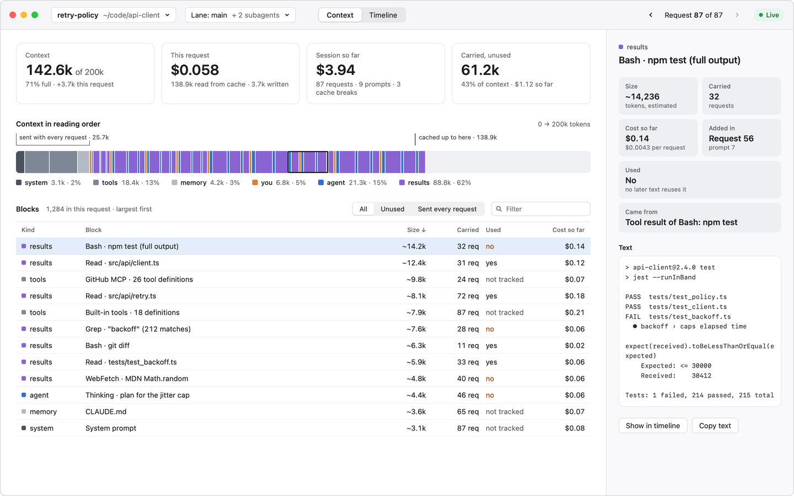
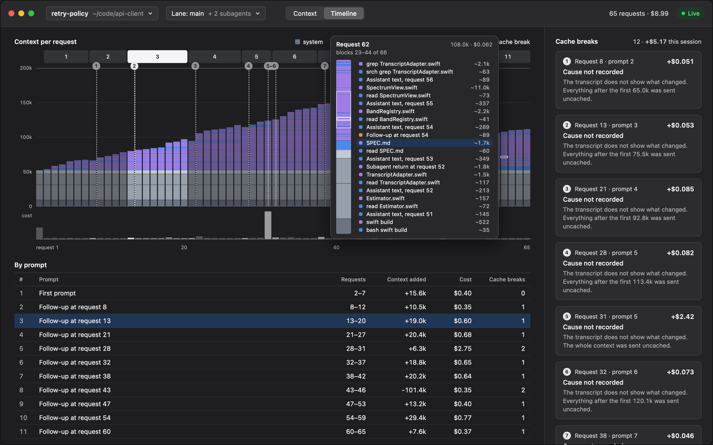
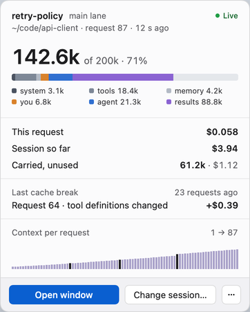

<h1 align="center">
  <picture>
    <source media="(prefers-color-scheme: dark)" srcset="docs/images/readme-logo-dark.svg">
    
  </picture>
</h1>

<p align="center"><strong>A spectrum analyzer for your agent's context window.</strong></p>

In a studio you never mix by ear alone. You put an analyzer on the bus and
suddenly you can *see* it: the mud at 300 Hz, the hi-hat eating the top end,
the reverb tail nobody asked for. ctxscope is that analyzer, pointed at the
context window of a coding agent.

Every request Claude Code sends carries the whole context: the system prompt,
the tool definitions, your memory files, every prompt, every file the agent
read, every command it ran, every thought. It grows with each step, it is sent
again on every request, and you pay for it every time. The harness shows you a
snapshot of it. ctxscope shows every request, block by block, with how long
each block has been carried, whether the agent ever used it again, and what
carrying it has cost.



## Why this exists

I come from music, and I build with agents all day. At some point I wanted to
know what my agents are actually *hearing*: what fills the context, where it
came from, what it costs to carry, and how much of it the agent ever used
again. I wanted to learn how harnesses manage context, look at my own agentic
apps the same way, and then start working on my own ideas for keeping context
lean for long agentic workloads.

You cannot optimize what you cannot see. So: an instrument first.

## What you see

### Context: the spectrum at one moment

Pick a request and see everything that was in it, in the order the model reads
it.

- **Four figures.** How full the context is, what this request cost, what the
  session has cost so far, and how much is carried but never used.
- **The strip.** Every block as its own slice, colored by kind: system, tools,
  memory, you, agent, results. Brackets show what is *sent with every request*
  and how far the cache reached. Hover for a magnifier that names each block,
  click to select one.
- **The blocks table.** Largest first, with size, how many requests it has
  been carried, whether later text reused it word for word, and what it has
  cost so far. Filter to the unused ones, or to what is sent every time.
- **The inspector.** Where a block came from, when it arrived, and its actual
  text.

### Timeline: the waterfall



One column per request, every block a slice, stacked from the bottom in
reading order. Above them your prompts as bands, below them what each request
cost. You can watch the context breathe: prompts pile on, a compaction
flattens it, a tool result lands like a kick drum.

- **Cache breaks** are marked where they happen, with the reason (memory
  changed, tool definitions changed, cache expired) and what it cost to send
  everything again.
- **By prompt.** Every prompt you typed, how many requests it turned into,
  what it added and what it cost.

### Menu bar: the level meter



A tiny meter with the current context size. Click it for the numbers, the last
cache break, and the session's shape at a glance.

## Getting started

ctxscope is a native macOS app. It needs **macOS 15 or later** on Apple
silicon, and [Claude Code](https://claude.com/claude-code).

### 1. Install

One command puts the latest release into Applications and opens it:

```bash
curl -fsSL https://github.com/imfabiokeller/ctxscope/releases/latest/download/ctxscope.zip -o /tmp/ctxscope.zip && ditto -x -k /tmp/ctxscope.zip /Applications && open /Applications/ctxscope.app
```

Look at the menu bar: ctxscope runs there, as a small meter next to the
clock, with no Dock icon and no window until you click it.

The app is not notarized yet. A zip that `curl` fetched carries no quarantine
flag, so macOS opens it without asking. If you download
`ctxscope-<version>.zip` from the
[latest release](https://github.com/imfabiokeller/ctxscope/releases/latest)
in the browser instead, macOS says the first time that it could not verify
that ctxscope is free of malware. Click **Done** (not Move to Trash), open
**System Settings > Privacy & Security**, scroll down to the line about
ctxscope, click **Open Anyway**, confirm with your password or Touch ID, and
open the app again. You only do this once. Or clear the flag before the first
launch instead:

```bash
xattr -dr com.apple.quarantine /Applications/ctxscope.app
```

Each release also carries a SHA-256 file; `shasum -a 256 -c
ctxscope-<version>.zip.sha256` checks the download.

### 2. Connect it to Claude Code

Click the menu bar meter, then **… > Connect**. ctxscope shows you the exact
change before writing anything: two small hook entries in
`~/.claude/settings.json`, so that Claude Code tells ctxscope when a session
starts and ends, and a `/ctxscope` skill in `~/.claude/skills/ctxscope`.
**Disconnect** takes both out again, byte for byte.

The skill runs a single command, `open ctxscope://...`, and carries its own
`allowed-tools` line for it. If your Claude Code still asks before running
it, add this permission to `~/.claude/settings.json`:

```json
{
  "permissions": {
    "allow": ["Bash(open ctxscope:*)"]
  }
}
```

### 3. Open a session

In a Claude Code chat started after connecting, type `/ctxscope`. The window
opens on that session and follows it live.

You can also pick any recent session from the menu bar or the window's session
menu. Nothing needs to be connected to look at past sessions.

### Build it yourself

With Xcode 26 installed:

```bash
git clone https://github.com/imfabiokeller/ctxscope.git
cd ctxscope
scripts/bundle.sh
open build/ctxscope.app
```

An app you built on your own Mac opens without any warning, and
`build/ctxscope.app` can be moved to Applications like the downloaded one.
`swift build --product ctxscope-cli` also gives you `ctxscope-cli connect`,
`disconnect` and `doctor` for the same change from the terminal.

## How it works

ctxscope reads the transcripts Claude Code already writes to
`~/.claude/projects`. It never writes there, never touches the network, and
sends no telemetry. Everything stays on your Mac.

- **Exact where it can be.** Request totals and costs come from the API's own
  token counts in the transcript.
- **Honest where it cannot.** A single block's size is estimated from its text
  and carries a `~`. The estimates are normalized so they always add up to the
  measured total.
- **Prices** are Anthropic's list prices per model, whatever plan you are
  on, with five-minute and one-hour cache writes at their own rates (see
  [known limitations](docs/HOW_IT_MEASURES.md#known-limitations)).

There is also a command line for the curious:

```bash
swift build -c release
.build/release/ctxscope-cli sessions
.build/release/ctxscope-cli analyze <session>
.build/release/ctxscope-cli export <session> --format csv
```

## Where it is going

- **Exact mode.** An optional local pass-through that records exactly what was
  sent, so every block is counted instead of estimated, and every cache break
  names its cause.
- **More harnesses.** Claude Code is the first input, not the only one. The
  capture layer already sits behind an adapter protocol, so Codex, other
  agents, and harnesses you build yourself can plug in the same way.
- **An open context trace.** Think OpenTelemetry, but for what is inside a
  context window: a small, open format any harness can emit (requests, blocks,
  kinds, cache boundaries, costs) and ctxscope, or anything else, can read.
- **From analyzer to mixing desk.** Once you can see it, you can shape it:
  experiments in holding blocks out, reordering for the cache, trimming what is
  carried but never used, and measuring what that does to cost and results.

## Under the hood

One Swift package, Swift 6 with strict concurrency, SwiftUI with a little
AppKit, no third-party dependencies.

| Module | Job |
|---|---|
| `ScopeCore` | The domain: blocks, kinds, requests, and pure analyzers for cost, cache, reuse and prompts |
| `ScopeCapture` | Reading transcripts: the Claude Code adapter and session discovery |
| `ScopeConnect` | The Connect edits and the local hook listener |
| `ScopeUI` | The design system, view models and views |
| `ctxscope` | The app: window, menu bar item, panel |

[docs/HOW_IT_MEASURES.md](docs/HOW_IT_MEASURES.md) says what it measures,
how exact each number is and what is still open,
[docs/ARCHITECTURE.md](docs/ARCHITECTURE.md) how it is built,
[docs/TRANSCRIPT_FORMAT.md](docs/TRANSCRIPT_FORMAT.md) what the transcripts
actually contain, and [docs/DEVELOPMENT.md](docs/DEVELOPMENT.md) how to build,
test and release it. Contributions and ideas are welcome, especially adapters
for other harnesses: see [CONTRIBUTING.md](CONTRIBUTING.md).

## License

ctxscope is free software under the
[GNU General Public License, version 3](LICENSE). Use it, change it, share
it; if you distribute a changed version, share its source the same way.
